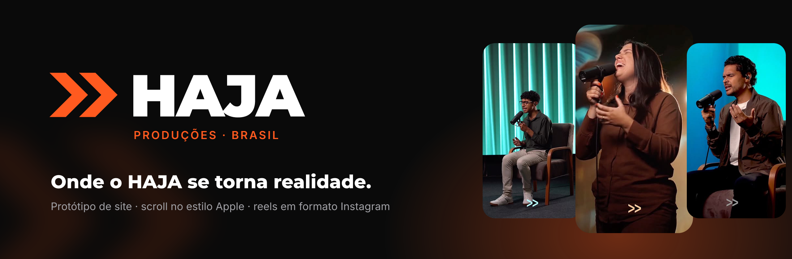
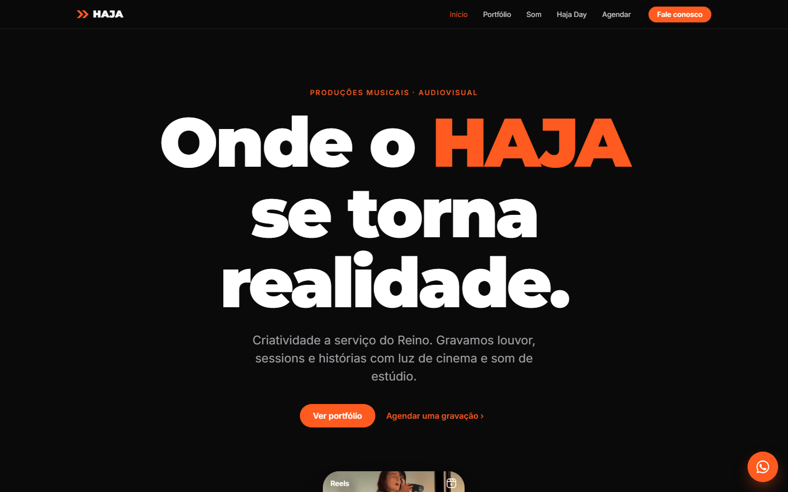
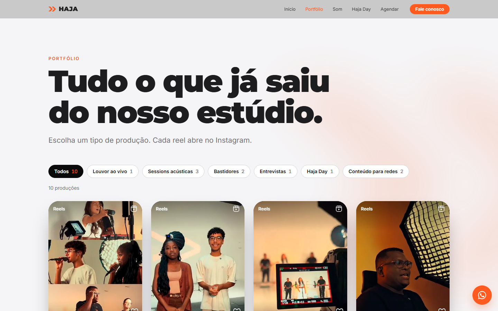
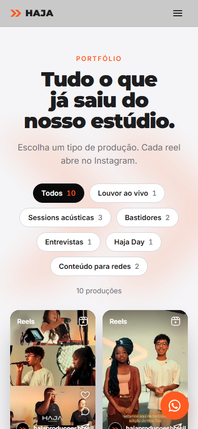
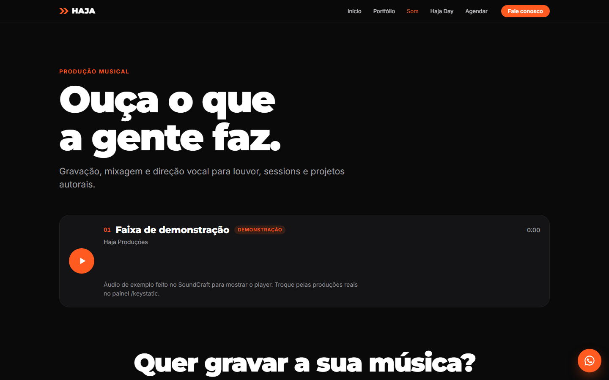
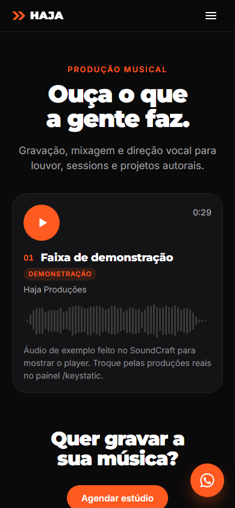
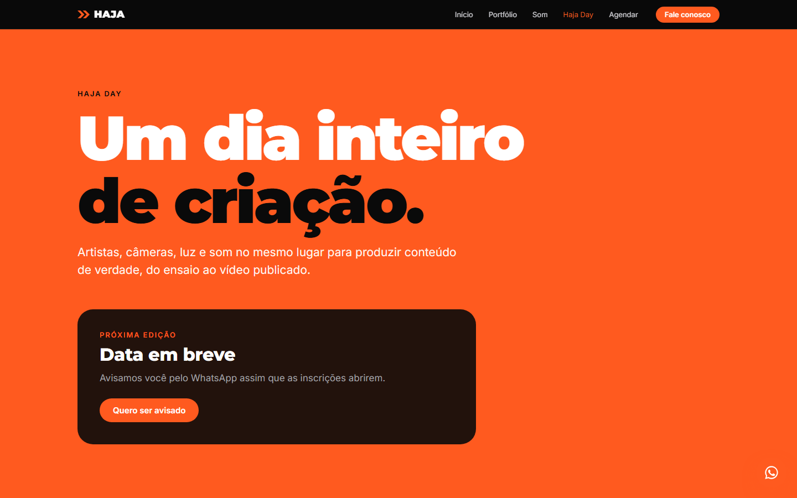
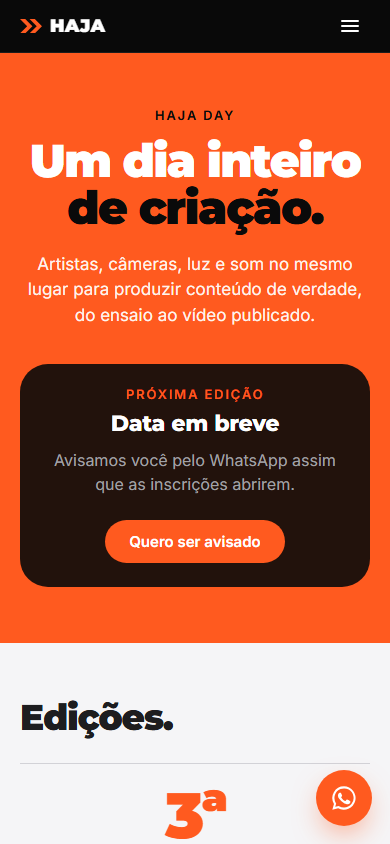
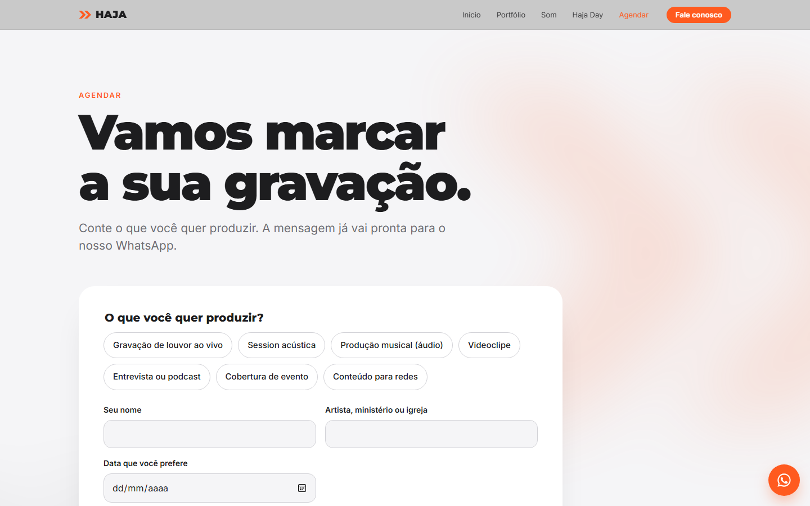
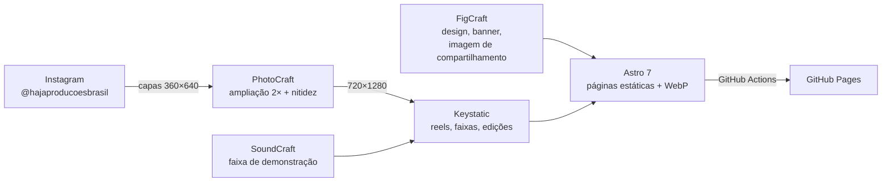

<a id="topo"></a>

<p align="center">
  
</p>

<p align="center">
  <a href="https://rafascoelho22.github.io/haja-site/"><strong>Ver o site no ar »</strong></a>
  &nbsp;·&nbsp;
  <a href="#editar-o-conteúdo-sem-código">Editar o conteúdo</a>
  &nbsp;·&nbsp;
  <a href="#capturas-de-tela">Capturas de tela</a>
  &nbsp;·&nbsp;
  <a href="https://www.instagram.com/hajaproducoesbrasil/">@hajaproducoesbrasil</a>
</p>

<p align="center">
  <a href="https://github.com/Rafascoelho22/haja-site/actions/workflows/pages.yml"></a>
  
  
  
  
  
</p>

---

<details>
  <summary><strong>Sumário</strong></summary>

1. [Sobre o projeto](#sobre-o-projeto)
2. [Páginas](#páginas)
3. [Capturas de tela](#capturas-de-tela)
4. [Editar o conteúdo sem código](#editar-o-conteúdo-sem-código)
5. [Configurações: agenda, Haja Day e métricas](#configurações-agenda-haja-day-e-métricas)
6. [Domínio próprio](#domínio-próprio)
7. [Como foi feito](#como-foi-feito)
8. [Estrutura de pastas](#estrutura-de-pastas)
9. [Rodar localmente](#rodar-localmente)
10. [Próximos passos](#próximos-passos)
11. [Créditos e direitos](#créditos-e-direitos)

</details>

## Sobre o projeto

Site da **Haja Produções Brasil**, produtora de música e audiovisual que trabalha com louvor ao vivo, sessions acústicas, entrevistas e conteúdo para redes.

A navegação segue a lógica das páginas de produto da Apple. A página vai se revelando conforme a pessoa rola, e os vídeos aparecem como o público já conhece: **reels verticais no formato do Instagram**, ao lado do texto.

- **Astro 7**: o site é gerado como páginas estáticas, rápido e hospedado de graça no GitHub Pages.
- **Keystatic**: um painel para a equipe da Haja adicionar reels, faixas e edições do Haja Day sem mexer em código.
- **Imagens otimizadas**: cada capa vira WebP em quatro tamanhos, e o navegador baixa só o que precisa (10 a 100 KB por capa).
- **Transições suaves** entre páginas, com a View Transitions API nativa do navegador.
- **Rolagem leve**: as revelações e a barra de progresso são animadas só com CSS (`animation-timeline`) onde o navegador permite, as seções abaixo da dobra só são desenhadas quando chegam perto da tela (`content-visibility`), e as fontes são servidas pelo próprio site.
- **Nada pesado antes do clique**: os clipes do YouTube e a agenda do Cal.com só carregam quando a pessoa pede.
- **Pensado para o celular**: conteúdo centralizado, menu próprio e botão de WhatsApp sempre à mão.
- **SEO**: título e descrição por página, imagem de compartilhamento, sitemap e dados estruturados (schema.org).
- **Acessível**: respeita a opção de reduzir animações, tem o atalho "Pular para o conteúdo", foco visível e rótulos em todos os reels e botões.

<p align="right"><a href="#topo">voltar ao topo ↑</a></p>

## Páginas

| Página | O que tem |
|---|---|
| **[Início](https://rafascoelho22.github.io/haja-site/)** | Abertura com reels em leque, manifesto que acende palavra por palavra, capítulos com o reel fixo na lateral, galeria horizontal, Haja Day, artistas atendidos (com números e letreiro), serviços e contato. |
| **[Portfólio](https://rafascoelho22.github.io/haja-site/portfolio/)** | Todos os reels, com filtro por tipo (louvor ao vivo, sessions, bastidores…). A grade se reorganiza com animação, e o filtro fica no link (`/portfolio/#sessions`). Abaixo, os clipes completos do YouTube, que só carregam no play. |
| **[Som](https://rafascoelho22.github.io/haja-site/som/)** | Player de áudio com forma de onda ([wavesurfer.js](https://wavesurfer.xyz)). Toca uma faixa por vez, e a forma de onda só carrega quando aparece na tela. O botão **Antes/Depois** troca entre a versão crua e a mixada no mesmo ponto da música. |
| **[Haja Day](https://rafascoelho22.github.io/haja-site/haja-day/)** | Próxima edição com contagem regressiva e link de inscrição (ou lista de espera por e-mail ou WhatsApp, enquanto não há data) e a lista das edições com os reels de cada uma. |
| **[Agendar](https://rafascoelho22.github.io/haja-site/agendar/)** | Agenda do [Cal.com](https://cal.com) dentro do site, quando configurada, carregada só ao clicar em "Ver horários". Sem ela, um formulário curto monta a mensagem e abre o WhatsApp. |

<p align="right"><a href="#topo">voltar ao topo ↑</a></p>

## Capturas de tela

| Desktop | Celular |
|:--|:--:|
|  |  |
|  |  |
|  |  |
|  |  |

<details>
  <summary>Página de agendamento</summary>



</details>

<p align="right"><a href="#topo">voltar ao topo ↑</a></p>

## Editar o conteúdo sem código

O conteúdo fica em arquivos dentro do próprio repositório e é editado pelo painel do **Keystatic**:

```bash
npm install        # só na primeira vez
npm run dev
# abra http://127.0.0.1:4321/keystatic
```

| No painel | O que muda no site |
|---|---|
| **Reels** | Título, artista, legenda, categoria, capa vertical (9:16), código do reel no Instagram, data e se aparece na página inicial. |
| **Clipes no YouTube** | Título, artista, código do vídeo, tipo (clipe ou ao vivo) e data. Aparecem no fim do portfólio. |
| **Artistas atendidos** | Nome, Instagram, link de um trabalho e ordem. Formam o letreiro da página inicial. |
| **Faixas de áudio** | Título, artista, descrição, arquivo (mp3, wav ou flac) e, opcionalmente, a versão antes da mixagem. Desmarque "Faixa de demonstração" ao subir uma produção real. |
| **Edições do Haja Day** | Número, data, resumo e os reels da edição. |
| **Configurações do site** | WhatsApp, Instagram (Brasil e Global), canal do YouTube, lista de espera, agenda do Cal.com, próximo Haja Day e métricas. |

Depois de salvar no painel, faça commit e push. O GitHub Actions publica o site sozinho em cerca de um minuto.

> O código do reel é o trecho depois de `/reel/` no link do Instagram. Em `instagram.com/hajaproducoesbrasil/reel/Dco2mE6hD3h/`, o código é `Dco2mE6hD3h`.

<p align="right"><a href="#topo">voltar ao topo ↑</a></p>

## Configurações: agenda, Haja Day e métricas

Tudo em **Configurações do site**, no painel (arquivo `src/content/site.yaml`):

- **Agenda (Cal.com):** crie uma conta gratuita em cal.com, um tipo de evento (por exemplo, "Gravação no estúdio") e cole o link curto, como `haja-producoes/estudio`. A página Agendar passa a mostrar a agenda. Com o campo vazio, ela usa o formulário pelo WhatsApp.
- **Próximo Haja Day:** com data e hora futuras, a página mostra a contagem regressiva. O link de inscrição pode ser um Google Forms ou um Tally. Sem data, aparece "Data em breve".
- **Lista de espera do Haja Day:** crie uma conta gratuita no [Buttondown](https://buttondown.com) e informe o usuário. A página passa a ter um campo de e-mail (sem script de terceiros). Vazio, o aviso é só pelo WhatsApp.
- **Métricas:** escolha **Plausible** (informe o domínio do site) ou **Umami** (informe o Website ID). As duas respeitam a privacidade e dispensam aviso de cookies. Os cliques em links externos, como o WhatsApp, também entram na contagem.

<p align="right"><a href="#topo">voltar ao topo ↑</a></p>

## Domínio próprio

1. Registre o domínio (ex.: `hajaproducoes.com.br` no registro.br).
2. No provedor de DNS, crie um registro `CNAME` de `www` para `rafascoelho22.github.io` e os registros `A` do domínio principal para os IPs do GitHub Pages (`185.199.108.153`, `185.199.109.153`, `185.199.110.153`, `185.199.111.153`).
3. No GitHub: **Settings → Secrets and variables → Actions → Variables → New variable**, com nome `DOMINIO` e valor `hajaproducoes.com.br`.
4. Rode o workflow de novo (aba **Actions → Publicar no GitHub Pages → Run workflow**). O site passa a usar a raiz do domínio, o `CNAME` é gerado e os links, o sitemap e a imagem de compartilhamento se ajustam sozinhos.
5. Em **Settings → Pages**, marque **Enforce HTTPS**.

<p align="right"><a href="#topo">voltar ao topo ↑</a></p>

## Como foi feito



| Ferramenta | Onde | O que fez |
|---|---|---|
| **FigCraft** | `figcraft/gerar.sh`, `banner.sh`, `og.sh` | Design desktop e mobile, design system, banner deste README e a imagem de compartilhamento 1200×630. |
| **PhotoCraft** | `scripts/melhorar-reels.sh` | Ampliou as capas de 360×640 para 720×1280 e aplicou *smart sharpen* com redução de ruído. Também cortou as capturas de celular deste README. |
| **SoundCraft** | `som/gerar-demo.sh` | Compôs e mixou a faixa de demonstração do player (pad, arpejo, baixo e batida, 80 BPM) e exportou em FLAC normalizado. Com `ANTES=1`, gera a versão crua (sem reverb, delay nem masterização) usada no botão Antes/Depois. |
| **Node** | `scripts/gerar-grao.mjs` | Gera a textura de granulado de filme (PNG de 10 KB que se repete), aplicada como imagem fixa em vez de filtro ao vivo. |
| **Astro** | `src/` | Páginas, componentes, otimização de imagem e sitemap. |
| **Keystatic** | `keystatic.config.ts` | Painel de conteúdo. Só roda no `npm run dev`, então o site publicado continua 100% estático. |

<p align="right"><a href="#topo">voltar ao topo ↑</a></p>

## Estrutura de pastas

```
haja-site/
├── src/
│   ├── pages/              # index, portfolio, som, haja-day, agendar, 404
│   ├── layouts/Base.astro  # <head> com SEO, menu, rodapé, WhatsApp flutuante
│   ├── components/         # Reel, YouTube, FundoLogo, Icones
│   ├── content/            # conteúdo editado pelo Keystatic (YAML)
│   │   ├── reels/  clipes/  artistas/  faixas/  edicoes/
│   │   └── site.yaml       # configurações
│   ├── assets/reels/       # capas (otimizadas no build)
│   ├── scripts/            # comportamentos de rolagem e menu
│   └── styles/             # global.css + paginas.css
├── public/                 # og.png, favicon, áudio, logo
├── keystatic.config.ts
├── astro.config.mjs
├── figcraft/  som/  scripts/   # fontes do design, do áudio e das imagens
├── img/ig/                 # capas originais baixadas do Instagram
├── docs/                   # banner e capturas deste README
└── .github/workflows/pages.yml
```

## Rodar localmente

Precisa do [Node.js](https://nodejs.org) 22.23 ou mais novo.

```bash
npm install
npm run dev       # site + painel em http://127.0.0.1:4321 (painel em /keystatic)
npm run build     # gera o site em dist/
npm run preview   # serve dist/ em http://localhost:4321/haja-site/
```

Para refazer os arquivos da suíte ArtCraft (instalada em `C:\Program Files\ArtCraft\`):

```bash
cd figcraft && bash gerar.sh && bash banner.sh && bash og.sh && cd ..
bash scripts/melhorar-reels.sh
bash som/gerar-demo.sh
ANTES=1 bash som/gerar-demo.sh
node scripts/gerar-grao.mjs
```

<p align="right"><a href="#topo">voltar ao topo ↑</a></p>

## Próximos passos

- [x] Revelação por rolagem e reels no formato Instagram
- [x] Astro + Keystatic, com a equipe editando sem código
- [x] Portfólio filtrável
- [x] Player de áudio com forma de onda
- [x] Página do Haja Day com contagem regressiva
- [x] Agendamento (Cal.com ou WhatsApp)
- [x] SEO, sitemap, imagem de compartilhamento e métricas opcionais
- [x] Preparado para domínio próprio
- [ ] Trocar as capas pelos **vídeos originais**, tocando em loop, e abrir um player estilo Stories ao clicar
- [ ] Subir as **produções musicais reais** no lugar da faixa de demonstração
- [x] Artistas atendidos, clipes do YouTube e histórico das edições do Haja Day
- [x] Comparação Antes/Depois no player de áudio
- [ ] Orçamento guiado em etapas, pacotes com preço "a partir de" e páginas de caso com depoimento
- [ ] SEO local: Perfil da Empresa no Google, `LocalBusiness` e uma página por edição do Haja Day
- [ ] Depoimentos de artistas e ministérios

> Rolagem com inércia (Lenis) foi avaliada e descartada: troca a rolagem nativa por um laço em JS a cada quadro e iria contra o trabalho de deixar a rolagem leve.

## Créditos e direitos

- Marca, logo, fotos e vídeos: **Haja Produções Brasil** ([@hajaproducoesbrasil](https://www.instagram.com/hajaproducoesbrasil/), [@hajaproducoesglobal](https://www.instagram.com/hajaproducoesglobal/)). Todos os direitos reservados. As imagens estão aqui como conteúdo do site da própria Haja.
- A faixa em `public/audio/faixa-de-demonstracao/` é um exemplo gerado no SoundCraft, não uma produção da Haja.
- Fontes: [Montserrat](https://fonts.google.com/specimen/Montserrat) e [Inter](https://fonts.google.com/specimen/Inter), sob a SIL Open Font License.
- Estrutura deste README inspirada em [Best-README-Template](https://github.com/othneildrew/Best-README-Template) e [awesome-readme](https://github.com/matiassingers/awesome-readme).

<p align="right"><a href="#topo">voltar ao topo ↑</a></p>
