<a id="topo"></a>

<p align="center">
  
</p>

<p align="center">
  <a href="https://rafascoelho22.github.io/haja-site/"><strong>Ver o site no ar »</strong></a>
  &nbsp;·&nbsp;
  <a href="#capturas-de-tela">Capturas de tela</a>
  &nbsp;·&nbsp;
  <a href="#como-foi-feito">Como foi feito</a>
  &nbsp;·&nbsp;
  <a href="https://www.instagram.com/hajaproducoesbrasil/">@hajaproducoesbrasil</a>
</p>

<p align="center">
  <a href="https://github.com/Rafascoelho22/haja-site/actions/workflows/pages.yml"></a>
  
  
  
  
</p>

---

<details>
  <summary><strong>Sumário</strong></summary>

1. [Sobre o projeto](#sobre-o-projeto)
2. [Capturas de tela](#capturas-de-tela)
3. [O que a página faz ao rolar](#o-que-a-página-faz-ao-rolar)
4. [Identidade visual](#identidade-visual)
5. [Como foi feito](#como-foi-feito)
6. [Estrutura de pastas](#estrutura-de-pastas)
7. [Rodar localmente](#rodar-localmente)
8. [Próximos passos](#próximos-passos)
9. [Créditos e direitos](#créditos-e-direitos)

</details>

## Sobre o projeto

Protótipo de site para a **Haja Produções Brasil**, produtora de música e audiovisual que trabalha com louvor ao vivo, sessions acústicas, entrevistas e conteúdo para redes.

A navegação segue a lógica das páginas de produto da Apple. A página vai se revelando conforme a pessoa rola, cada faixa conta uma parte da história e os vídeos aparecem do jeito que o público já conhece: **reels verticais no formato do Instagram**, ao lado do texto.

- **Uma página só**, sem framework e sem etapa de build: HTML, CSS e JavaScript puros.
- **Preto e laranja** da marca, com faixas brancas para a página respirar.
- **Pensada para o celular** desde o início: no celular, os conteúdos ficam centralizados e os reels viram um carrossel de deslizar.
- **Acessível**: respeita a opção do sistema de reduzir animações, o foco do teclado fica visível e todo reel tem um rótulo para leitores de tela.

<p align="right"><a href="#topo">voltar ao topo ↑</a></p>

## Capturas de tela

| Desktop | Celular |
|:--|:--:|
| 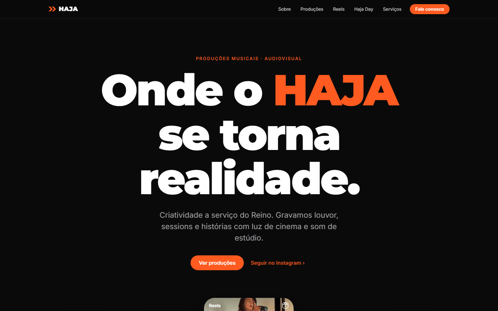 | 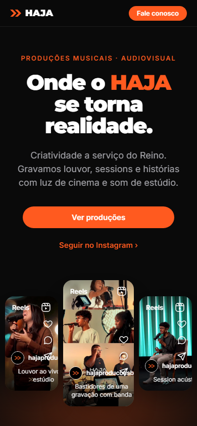 |
| 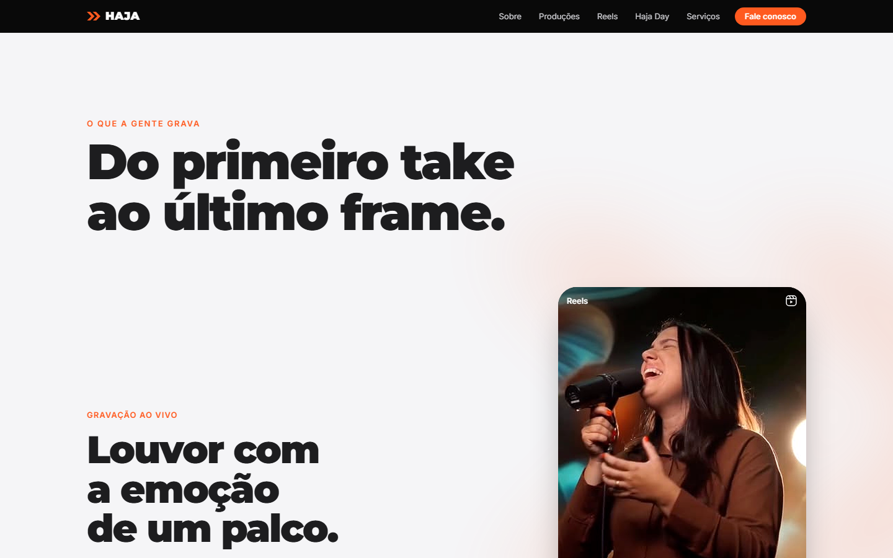 | 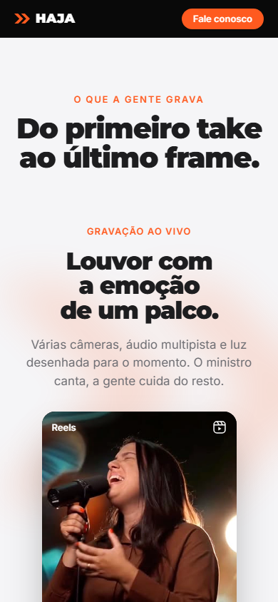 |
| 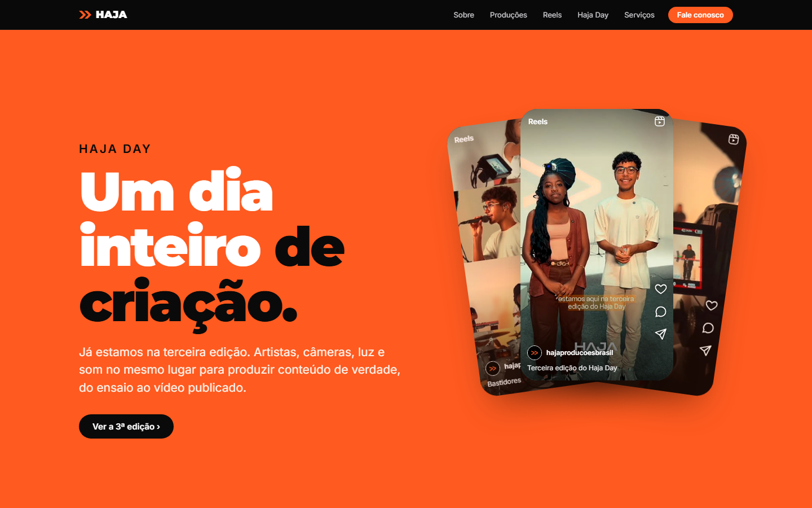 | 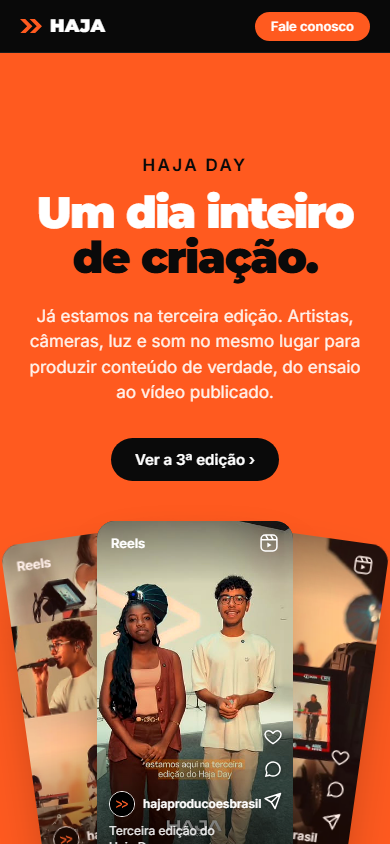 |

<details>
  <summary>Mais telas do desktop</summary>

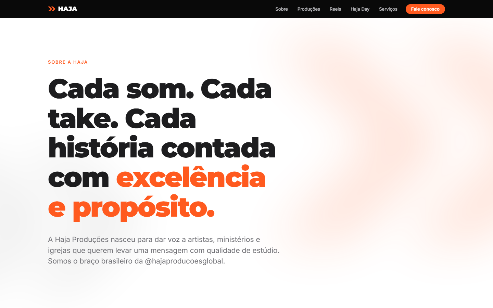 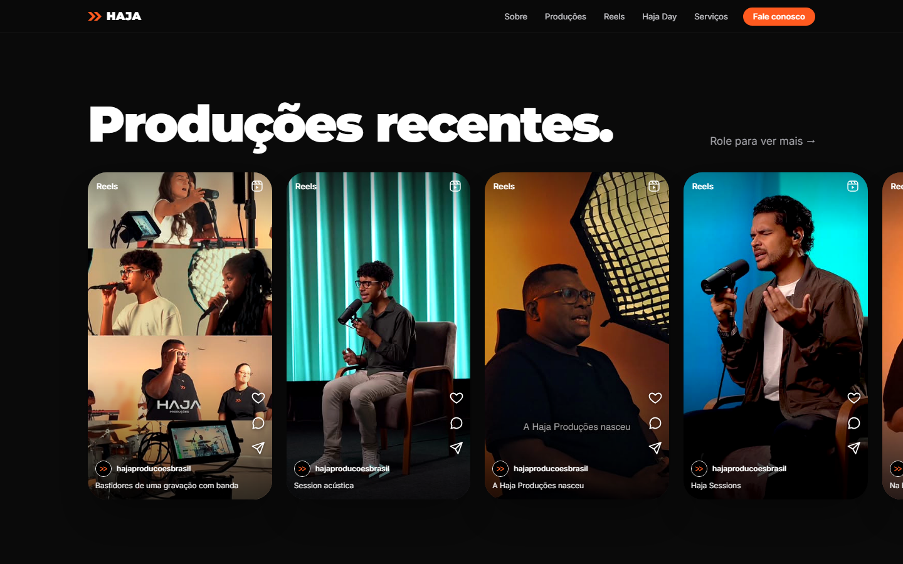
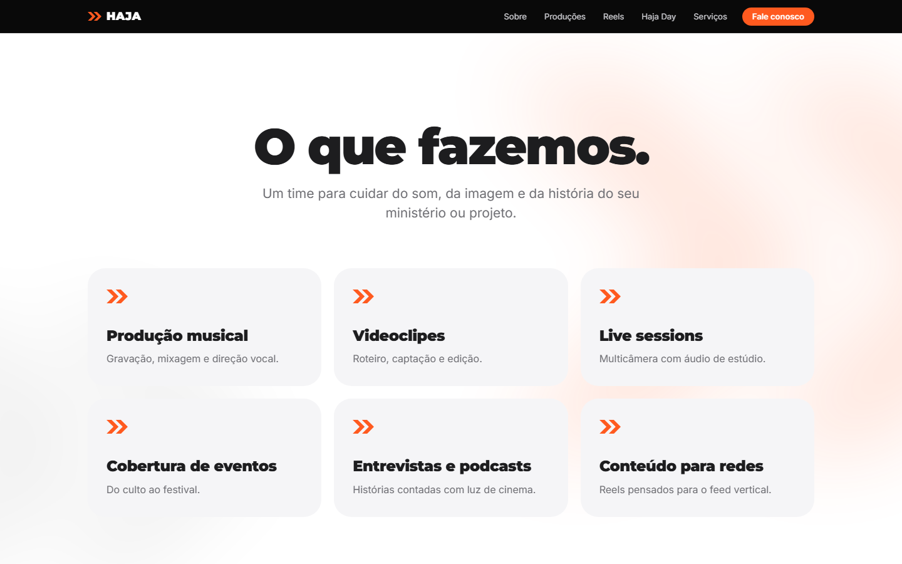 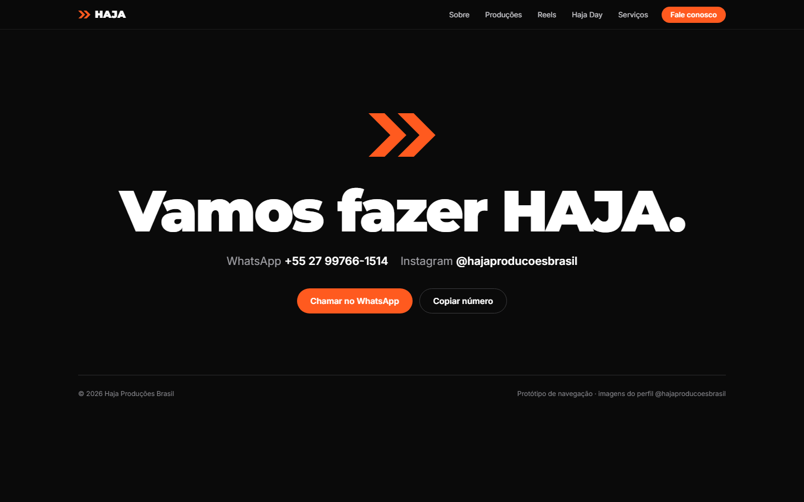

</details>

<p align="right"><a href="#topo">voltar ao topo ↑</a></p>

## O que a página faz ao rolar

| Faixa | Fundo | Comportamento |
|---|---|---|
| **Abertura** | preto | O título entra palavra por palavra e os reels começam em leque, alinhando-se conforme a rolagem. |
| **Manifesto** | branco | A frase acende palavra por palavra, com o fim em laranja. O logo `>>` desfocado fica ao fundo. |
| **Produções** | cinza claro | O texto rola à esquerda e o **reel fica fixo na lateral**, trocando a cada capítulo, com indicador de progresso. |
| **Produções recentes** | preto | A rolagem vertical move a fileira de reels para o lado. |
| **Haja Day** | laranja | Três reels se abrem em leque quando a faixa entra na tela. |
| **Serviços** | branco | Seis cartões aparecem em sequência. |
| **Contato** | preto | Link para o WhatsApp e botão para copiar o número. |

A barra do menu é translúcida, troca de cor ao passar pelas faixas claras e mostra uma linha laranja com o progresso da leitura.

<p align="right"><a href="#topo">voltar ao topo ↑</a></p>

## Identidade visual


| Token | Cor | Uso |
|---|---|---|
| `--preto` | `#0A0A0A` | fundo principal, menu |
| `--laranja` | `#FF5A1F` | marca, botões, destaques |
| `--branco` | `#FFFFFF` | faixas de leitura |
| `--cinza` | `#F5F5F7` | faixa de produções, cartões |
| `--grafite` | `#1D1D1F` | texto sobre fundo claro |

**Tipografia:** Montserrat Black nos títulos, por ser próxima do logotipo HAJA, e Inter no texto corrido.

<p align="right"><a href="#topo">voltar ao topo ↑</a></p>

## Como foi feito

O projeto foi produzido com a suíte **ArtCraft**, por linha de comando:

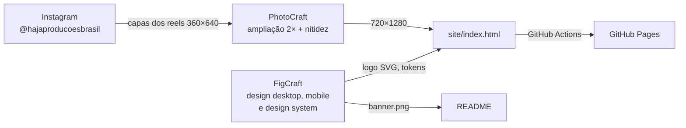

1. **FigCraft** (`figcraft/gerar.sh`): gera o arquivo `haja-site.figcraft` com a landing desktop (1440 px), a versão mobile (390 px) e o design system. O `banner.sh` monta o banner deste README.
2. **PhotoCraft** (`scripts/melhorar-reels.sh`): amplia as capas dos reels de 360×640 para 720×1280 (reamostragem *preserve details*) e aplica *smart sharpen* com redução de ruído.
3. **Site** (`site/index.html`): um único arquivo. A rolagem usa `IntersectionObserver` e `requestAnimationFrame`, sem nenhuma biblioteca.
4. **Deploy** (`.github/workflows/pages.yml`): a cada push na `main`, o GitHub Actions publica a pasta `site/` no GitHub Pages.

<p align="right"><a href="#topo">voltar ao topo ↑</a></p>

## Estrutura de pastas

```
haja-site/
├── site/                  # o site publicado
│   ├── index.html
│   └── img/
│       ├── hd/            # capas dos reels tratadas no PhotoCraft
│       ├── logo-haja.svg  # exportado do FigCraft
│       └── perfil.jpg
├── figcraft/              # arquivos de design
│   ├── haja-site.figcraft
│   ├── banner.figcraft
│   ├── gerar.sh / banner.sh
│   └── png/               # exportações dos quadros
├── img/ig/                # capas originais baixadas do Instagram
├── scripts/melhorar-reels.sh
├── docs/                  # banner e capturas de tela deste README
└── .github/workflows/pages.yml
```

## Rodar localmente

Não tem dependências. Basta abrir `site/index.html` no navegador ou, para simular o servidor:

```bash
cd site
python -m http.server 8000   # ou: npx serve
# abra http://localhost:8000
```

Para refazer o design ou as imagens (é preciso ter o ArtCraft instalado em `C:\Program Files\ArtCraft\`):

```bash
cd figcraft && bash gerar.sh && "/c/Program Files/ArtCraft/FigCraft/figcraft-cli.exe" run script.jsonl --out haja-site.figcraft
bash scripts/melhorar-reels.sh
```

<p align="right"><a href="#topo">voltar ao topo ↑</a></p>

## Próximos passos

- [x] Landing com revelação por rolagem
- [x] Reels no formato Instagram com o reel fixo na lateral
- [x] Versão mobile centralizada
- [x] Capas tratadas no PhotoCraft
- [ ] Trocar as capas pelos **arquivos de vídeo originais** (tocando em loop, sem som), para a qualidade máxima
- [ ] Página própria do Haja Day, com agenda e inscrição
- [ ] Portfólio filtrável por tipo de produção
- [ ] Formulário de orçamento ligado ao WhatsApp

## Créditos e direitos

- Marca, logo, fotos e vídeos: **Haja Produções Brasil** ([@hajaproducoesbrasil](https://www.instagram.com/hajaproducoesbrasil/), [@hajaproducoesglobal](https://www.instagram.com/hajaproducoesglobal/)). Todos os direitos reservados. As imagens estão aqui apenas como conteúdo de referência do protótipo.
- Fontes: [Montserrat](https://fonts.google.com/specimen/Montserrat) e [Inter](https://fonts.google.com/specimen/Inter), sob a SIL Open Font License.
- Estrutura deste README inspirada em [Best-README-Template](https://github.com/othneildrew/Best-README-Template) e [awesome-readme](https://github.com/matiassingers/awesome-readme).

<p align="right"><a href="#topo">voltar ao topo ↑</a></p>
